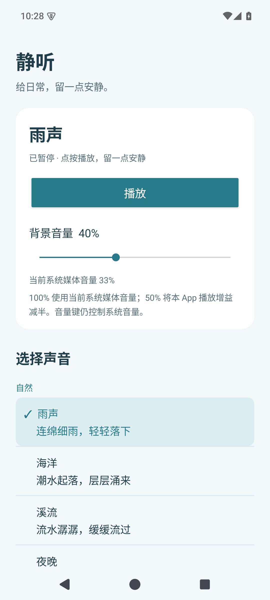

# 静听·背景音

原生 Android 离线背景音 App。使用用户提供的背景音音源，支持 Android 8.0（API 26）及以上。

## 功能

- 15 类音源、83 个原始 M4A 文件，约 234 分钟，完整内置，不重编码。
- 同类分段按数字顺序连续播放，播放完最后一段后循环。
- 前台媒体播放服务支持切换应用、锁屏和从最近任务移除界面后继续播放。
- 通知栏及锁屏播放/暂停/停止；耳机断开自动暂停。
- 独立 0–100% 音量，记忆音量与音源。默认 40%，首次打开不会自动发声。
- 不申请音频焦点，不主动打断其他应用。无需网络、存储访问或账户。

百分比表示播放器线性增益：0% 静音、50% 为 0.5、100% 为 1.0，再由系统媒体音量作用于输出。系统音量档位不是感知响度的线性百分比，因此不把两个界面百分比相乘当作实际响度。音量键仍调整系统媒体音量。

## 下载

[下载最新正式 APK](https://github.com/Sorin-n/quiet-background-android/releases/latest) · [v1.0.0 发布页](https://github.com/Sorin-n/quiet-background-android/releases/tag/v1.0.0)

APK 约 457 MB，音源全部内置。校验值和安装说明随 Release 一起提供。



## 安装与使用

将 `dist/静听背景音-v1.0.0-release.apk` 传到 Android 手机，打开 APK 安装。若系统询问，为当前文件管理器开启“允许安装未知应用”。安装后选择声音并点按播放；Android 13 及以上可允许通知以方便控制。

这是签名的 Release APK，非调试包。音源全部保留，因此 APK 约 460 MB。首次安装需预留足够存储。应用没有开机自动播放；系统强制停止后需手动打开。部分厂商的省电管理可能中断后台播放，可在该手机的电池设置中允许本 App 后台运行。其他应用自身主动暂停、电话/系统策略强制静音等情况无法由本 App 保证覆盖。

## 开发与构建

技术栈：Java 17、Gradle 8.13、Android Gradle Plugin 8.13.0、compile/target SDK 36、Media3 ExoPlayer 1.9.3，原生 Android View。

克隆后安装 JDK 17 和 Android SDK，设置 `JAVA_HOME`、`ANDROID_HOME`，即可构建可安装的调试包（不需要发布签名）：

```sh
./gradlew testDebugUnitTest lintRelease assembleDebug
```

调试包位于 `app/build/outputs/apk/debug/app-debug.apk`。

发布签名不包含在仓库中。构建自己的 Release 前，准备 `signing/quiet-release.jks`（密钥别名 `quiet`），并在 `signing/release.properties` 设置 `storePassword` 和 `keyPassword`。

原开发机工具位于 `.tools/`；`scripts/build.sh` 自动使用该环境。签名环境准备好后运行（需 zsh）：

```sh
./scripts/build.sh
```

脚本执行单元测试、Release lint、R8 优化、签名打包、签名校验、生成 SHA-256。产物位于 `dist/`。

其他机器需安装 JDK 17、Android SDK 36 / Build Tools 36.0.0，设置 `JAVA_HOME` 与 `ANDROID_HOME` 并更新 `local.properties`。Android Studio 可直接导入工程。

签名文件为 `signing/quiet-release.jks`，密码在 `signing/release.properties`，都已排除版本控制且限制为当前用户读写。请一并私密备份，以后覆盖升级必须沿用同一签名；勿把密码或密钥放入公开源码包。

## 测试

```sh
./gradlew testDebugUnitTest lintRelease
./gradlew connectedDebugAndroidTest
./gradlew -PincludeMixProbe :mixprobe:assembleDebug
```

仪器测试验证所有音源可播放、数字分段排序、播放增益端点、不改变系统音量、并行播放器、后台持续播放、片段切换与循环。耳机断开处理另外通过模拟器系统广播验证。`test-fixtures/mixprobe` 是独立包名/UID 的音频焦点测试 App，仅在传入 `-PincludeMixProbe` 时加入工程，不包含在交付 APK 中。模拟器自动化不能代替所有品牌真机的功耗、长时间锁屏、蓝牙和主观听感测试。

## 资料

- `docs/audio-manifest.json`：原始压缩包、文件大小、时长、SHA-256，用于核对去重和音源完整性。
- `docs/audio-validation.json`：逐文件 FFmpeg 完整解码结果。
- `docs/validation.md`：实际执行的验收结果。
- `docs/design.md`：界面方案。
- [Media3 官方源码与 API](https://github.com/androidx/media)：ExoPlayer 显式关闭音频焦点处理，通过 `setVolume` 设置本播放器增益。
- [Android 前台媒体播放服务文档](https://developer.android.com/develop/background-work/services/fgs/service-types#media)：后台播放使用 `mediaPlayback` 服务类型。

音频来自用户提供的原文件；工程没有加入 Apple 品牌标识，也没有变更原始音频内容。
